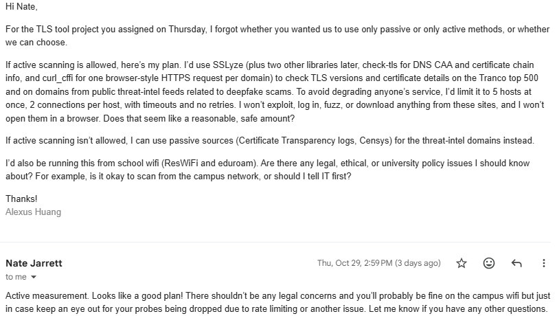

# Error Log: TLS Deepfake Audit Project

**Student:** [Your name]
**Started:** 2026-10-28
**Last updated:** 2026-11-01
**Environment:** Windows, cmd terminal in VS Code, Python 3.12.2, pytest 9.2.0, SSLyze, pandas

This log records every error, bug, mistake, obstacle, and challenge I hit, with the cause, the fix, and what I learned. Some mistakes came from AI-generated guidance, and those are marked **(AI error)** for honesty.

## Summary table

| # | Phase | Problem | Category |
|---|-------|---------|----------|
| 1 | 1 | pytest crashed with `'NodeId' object has no attribute '_str_cache'` | Version compatibility |
| 2 | 1 | `python` gave 3.10 but `python3` gave 3.13 | Environment |
| 3 | 1 | `Remove-Item` not recognized | Wrong shell (AI error) |
| 4 | 1 | `py -3.13` found no runtime | Wrong assumption (AI error) |
| 5 | 1-2 | Project was described as "passive" scanning | Conceptual error (AI error) |
| 6 | 1 | Project folder was inside OneDrive | Environment |
| 7 | 2 | `more` could not access the Tranco file (still zipped) | File handling |
| 8 | 2 | Extracted "file" was actually a folder | File handling |
| 9 | 2 | `pytest` "Fatal error in launcher" after moving the folder | Broken venv |
| 10 | 2 | `venv` creation failed with "Permission denied" | Locked files |
| 11 | 2 | Typos in commands (`auditv`, doubled `more` command) | Human error |
| 12 | 1 | Unsure how to phrase the instructor email ("not to get flagged") | Ethics / communication |
| 13 | 3 | Blueprint missed the cipher suite requirement | Planning gap (AI error) |
| 14 | 1 | Phase 1 scan time and network not recorded | Process gap |
## Detailed entries

### 1. pytest INTERNALERROR (`_str_cache`)
- **Symptom:** `pytest -v` printed a long INTERNALERROR traceback ending in `AttributeError: 'NodeId' object has no attribute '_str_cache'`.
- **Likely cause:** A newer pytest running on the very first Python 3.10 release (3.10.0). **This is an inference, not confirmed.** The error disappeared after moving to Python 3.12.2 with pytest 9.2.0, which is consistent with the guess but doesn't prove it.
- **Fix:** Rebuilt the virtual environment using Python 3.12.
- **Lesson:** Early point releases of Python can break newer packages. Check versions first when a library crashes inside its own code.

### 2. Multiple Python installs
- **Symptom:** `python --version` gave 3.10.0 and `python3 --version` gave 3.13.x.
- **Cause:** Several Pythons are installed (C:\Python310, miniconda, and the Microsoft Store stub). I never identified exactly where the 3.13 came from.
- **Fix:** Ran `py -0` to list what the Python launcher sees (3.12 and 3.10), and chose 3.12.
- **Lesson:** `where python` shows which executable runs. Inside a venv, the first result should be the `.venv` path.

### 3. `Remove-Item` not recognized **(AI error)**
- **Symptom:** `'Remove-Item' is not recognized as an internal or external command`.
- **Cause:** The commands given were for PowerShell, but my terminal is cmd.
- **Fix:** Used the cmd equivalent, `rmdir /s /q .venv`, and cmd's activate script (`.venv\Scripts\activate.bat`).
- **Lesson:** Commands depend on the shell. Check which shell you're in before copying commands.

### 4. `py -3.13` found no runtime **(AI error)**
- **Symptom:** "No suitable Python runtime found."
- **Cause:** The guidance assumed 3.13 was installed for the `py` launcher. It wasn't.
- **Fix:** Used `py -0` to see the real list and chose 3.12.
- **Lesson:** Verify what's installed instead of assuming.

### 5. "Passive" vs "active" scanning **(AI error)**
- **Symptom:** The draft email said "passive TLS handshake analysis."
- **Cause:** SSLyze connects to the target server, so it is **active** scanning. Passive means not contacting the target (e.g., Certificate Transparency logs, Censys).
- **Fix:** Corrected the wording before sending anything. Asked my instructor which approach is allowed.
- **Lesson:** Passive = analyze existing data. Active = send traffic to the target, even if the traffic is gentle.

### 6. Project inside OneDrive
- **Symptom:** None at first, but it's a known risk. OneDrive syncing can slow down or corrupt a venv and `.git` folder.
- **Fix:** Moved the project to `C:\dev\tls-deepfake-audit`.
- **Lesson:** Keep dev projects out of cloud-synced folders. This move directly caused entry 9.

### 7. Tranco file still zipped
- **Symptom:** `more data\raw\top-1m.csv` said "Cannot access file."
- **Cause:** `dir data\raw` showed only `top-1m.csv.zip`.
- **Fix:** Extracted the zip.
- **Lesson:** Run `dir` before assuming a path exists.

### 8. Extracted "file" was a folder
- **Symptom:** After extracting, `more` still failed. The VS Code Explorer showed an expand arrow next to `top-1m.csv`.
- **Cause:** Windows "Extract All" created a folder named `top-1m.csv` with the real CSV inside.
- **Fix:** Renamed the folder, moved the CSV up one level, and deleted the empty folder.
- **Lesson:** An expand arrow in the Explorer means it's a folder, whatever its name looks like.

### 9. "Fatal error in launcher" after moving the project
- **Symptom:** `pytest -v` failed with "Unable to create process using ...OneDrive\Desktop...\python.exe."
- **Cause:** A virtual environment stores its own absolute path inside launcher programs like `pytest.exe`. Moving the folder left them pointing at the old OneDrive location.
- **Workaround:** `python -m pytest -v` worked, because it doesn't use the broken launcher.
- **Fix:** Deleted and rebuilt the venv in the new location and reinstalled from `requirements.txt`.
- **Lesson:** Virtual environments can't be moved. Rebuild them. Using `python -m pip` and `python -m pytest` is more reliable on Windows.

### 10. `venv` "Permission denied"
- **Symptom:** `py -3.12 -m venv .venv` failed with `[Errno 13] Permission denied: ...\.venv\Scripts\python.exe`.
- **Likely cause:** The old `.venv` was only partly deleted, or something was holding `python.exe` open (VS Code's Python extension, or antivirus). **The exact cause was not confirmed**: `taskkill` reported no running python process.
- **Fix:** Ran the delete again from a fresh cmd window outside VS Code, confirmed `.venv` was gone with `dir .venv`, then recreated it.
- **Lesson:** Close VS Code and delete from a separate terminal when a folder won't delete, then confirm the deletion before recreating.

### 11. Typos
- **Symptoms:** `cd C:\dev\tls-deepfake-auditv` ("path not found"), and a doubled command (`more data\raw\top-1m.csvmore data\raw\top-1m.csv`).
- **Fix:** Retyped the commands.
- **Lesson:** Read the error message and the path first. Many "errors" are typos.

### 12. Wording the email sent to Nate
- **Challenge:** My draft said the rate limits were "to not be flagged."
- **Issue:** That sounds like evading detection. The real purpose of the limits (5 hosts in parallel, 2 connections per host, timeouts, no retries) is to avoid degrading anyone's service.
- **Fix:** Reworded the email to explain the honest purpose, disclosed the later use of curl_cffi, and asked about campus network (ResWiFi/eduroam) policy.
- **Lesson:** Say why a safeguard exists, and don't try to hide scanning activity.

### 13. Blueprint missed the cipher suite requirement **(AI error)**
- **Symptom:** Nate's second email said the tooling must fetch **TLS cipher suites**. The original blueprint focused on protocol versions and certificate details, not cipher suite enumeration.
- **Cause:** The AI-generated plan was written without the instructor's full requirements.
- **Fix:** Added accepted cipher suites per TLS version to the Phase 3 scope.
- **Lesson:** Check the assignment's actual requirements against the plan before building, and re-check when the instructor clarifies.

### 14. Phase 1 scan time and network not recorded
- **Symptom:** While filling in the scan log, I couldn't remember what time my first scan (SSLyze on example.com) ran or which network I was on.
- **Cause:** I didn't record the log entry when the scan happened.
- **Fix:** Reconstructed a time window from git commit timestamps (Phase 1 commits at 12:34 PM and 12:57 PM PDT on 2026-10-28). The scan most likely ran before the first commit. I marked the log entry as reconstructed, not exact, and wrote "not recorded" for the network.
- **Lesson:** Log each scan when it happens, ideally automatically. From Phase 3 on, the scanner script will write the start time, network label, domains, and settings to a run record itself, so the log doesn't depend on memory.

### 15. `sslyze.__version__` printed a module **(AI error)**
- **Symptom:** The version command printed `<module 'sslyze.__version__' ...>` instead of a version number.
- **Cause:** In SSLyze, `__version__` is a submodule. The command was written without checking.
- **Fix:** Use `python -m pip show sslyze`.
- **Lesson:** Verify a library's API before relying on it.

### 16. SSLyze defaults conflict with the agreed limits
- **Finding:** `network_max_retries` defaults to 3, but the plan promised no retries. Scanner concurrency limits default to `None`.
- **Impact:** The Phase 1 smoke test (SSLyze CLI, example.com) ran with default settings, including 3 retries.
- **Decision:** All later scans set every limit explicitly from `ScanConfig`.
- **Related:** Cipher suite enumeration sends a few hundred handshakes per host, at most 2 at a time. Vulnerability probes (Heartbleed, CCS injection, ROBOT, renegotiation) are excluded to keep to the "no exploiting" promise.
## Approval and requirements record

### Approval from email with Nate
- **Source:** Email replies from Nate (screenshot below).

- **Reply 1, received [10/29/2026]:** Confirmed the project is **active measurement**. Said the plan looked good, there shouldn't be legal concerns, and campus wifi is probably fine. Advised watching for probes being dropped due to rate limiting or other issues.
- **What the approved plan included:** SSLyze, check-tls, and curl_cffi; Tranco top 500 plus domains from public threat-intel feeds; limits of 5 hosts at once, 2 connections per host, timeouts, no retries; no exploiting, logging in, fuzzing, or downloading from sites; no opening domains in a browser.
- **Reply 2, received [10/29/2026]:** Project requirements (see below).
- **Caveat:** Wifi answer was "probably fine," not a guarantee. Nate is not campus IT and I did not email IT. 
**Decision:** proceed with the project, and stop scanning and tell Nate if anyone contacts me.

### Nate's reply regarding TLS Version, scale, written comparison(received [11/1/2026])
- **TLS versions:** "I think sticking to the TLS 1.3 should be sufficient." **Decision:** TLS 1.2 is not added. Scans stay at certificate info + TLS 1.3 only.
- **Scale:** The 100k figure is meant to guide building tooling that works at scale in a reasonable time. A large probing run taking a few days is expected, but it shouldn't take weeks. He will share larger datasets next week.
- **Written comparison of libraries:** Not required, but he said it could make a strong section in the presentation/report. **Decision:** I will include one (speed, output detail, and extrapolated time for 100k hosts), since the report is graded.
- **Not yet answered:** whether threat-intel domains may be scanned now. I am holding those scans until he provides datasets next week.
- **Limits:** unchanged (5 hosts, 2 connections per host, 5 s timeout, 1 attempt). No request was made to raise them.
- **Screenshot:** saved as `docs/approval_reply3.png`.
### Requirement clarification
- Find Python libraries that fetch **TLS cipher suites** from web servers and implement that tooling.
- Consider how long each library would take on **100,000+ hosts** when choosing.
- Tooling due **11/5**. Finding a larger dataset comes after.

### Conflict: scale vs. safety limits
- At 5 hosts in parallel, a 100k-host run would take days (my unmeasured estimate, to be replaced with benchmark numbers).
- **Decision:** Keep all ceilings in `config.py` unchanged. Benchmark on a small batch and extrapolate to 100k.
- **No ceiling will be raised without Nate's written approval.**

### Ground rules for scanning
1. No changes to the limits in `config.py` without written approval.
2. No retries or workarounds for dropped probes. Failures are recorded as data.
3. Benign domains only until the first test works and Nate confirms threat-intel scanning is fine right now.
4. Never open scanned domains in a browser or download anything from them.
5. Keep the scan log below up to date.
6. If a site operator or IT contacts me: stop and tell Nate.
7. Keep threat feeds and scan results out of GitHub. Defang malicious domains in anything shared.

## Scan log (every time traffic is sent to a real host)

| Date | Time | Network | Domains | Tool and limits | Notes |
|------|------|---------|---------|-----------------|-------|
| 2026-10-28 | [Before 12:57 PM PDT, probably before 12:34 PM (reconstructed from git history; exact time not recorded)] | [home / ResWiFi / eduroam] | example.com | SSLyze `--certinfo`, default settings (not ScanConfig) | Phase 1 smoke test. A real active scan of a documentation domain. |
| 2026-11-01 | 4:53 PM PST | [your network] | example.com | SSLyze via ScanConfig: 5 hosts, 2 conn/host, 5 s timeout, 1 attempt. Cert info + TLS 1.3 only | First Tier 1 scan. Succeeded; 3 of 5 TLS 1.3 ciphers accepted, 90-day cert. |
## Observations for the report
- example.com's certificate was valid for 90 days (2026-09-26 to 2026-12-25), typical of automated issuance, so validity length will be a feature to compare across groups.
- No dedicated "deepfake host" feed was found. The threat-intel list will have to be assembled from phishing feeds or published research, and the selection method must be documented as a study limitation.
- Many malicious sites sit behind shared hosting (e.g., Cloudflare), so TLS posture may reflect the host more than the site operator.

## Open items
- [x] Nate's reply on which TLS versions (TLS 1.3 only)
- [x] Nate's reply on written comparison (optional, doing it)
- [ ] Nate's datasets next week; confirm scanning them is approved
- [ ] Scale-readiness: parallel DNS, resume support, measured dead-host rate
- [ ] Researched check-tls and curl_cffi: both exist on PyPI, capabilities to be confirmed from docs

## Phase status (updated 2026-11-01)

| Phase | Status |
|-------|--------|
| 1. Environment setup | Done. SSLyze smoke test on example.com printed certificate info. |
| 2. Dataset and safety config | Done. 28 tests pass on Python 3.12.2. No network traffic sent. |
| 3. SSLyze prototype (now includes cipher suites) | Approved, starting. No traffic sent yet. |
| 4. Three libraries | Not started |
| 5. GitHub | Phase 2 pushed; |